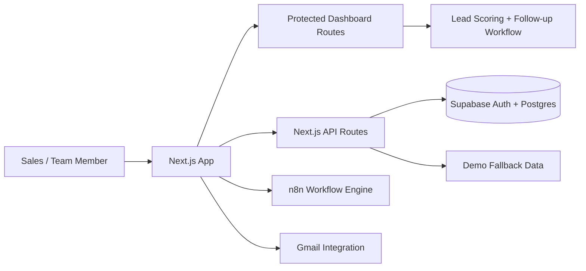

# LeadForge

LeadForge is a Next.js-based real estate lead intelligence platform designed to help sales teams manage leads, score them, review follow-ups, and automate outreach workflows. The product combines a modern dashboard UI with data-backed lead management, Supabase authentication, and workflow automation hooks for downstream orchestration.

This repository is best understood as a portfolio-ready MVP for an AI-assisted lead operations product. It demonstrates production-minded frontend architecture, server-side validation, Supabase integration, typed data models, and workflow orchestration patterns. It is intentionally built with a demo-safe runtime mode so it can be explored without live credentials.

## Project status

Status: MVP / demo-ready prototype / functional product slice

The repository includes a working product shell, lead data model, demo data, dashboard flows, auth integration points, and workflow automation scaffolding. It also clearly documents that not all live features are enabled by default.

Important boundaries:

- The app runs in a demo mode when Supabase credentials are not configured.
- The repo intentionally keeps live Gmail and automation features behind approval gates.
- It is designed as a product prototype and not as a fully deployed production SaaS system.

## Live demo

No verified production deployment URL is included in the repository. The app is intended to run locally or in a hosting environment with the required Supabase configuration.

## Engineering highlights

- Next.js 15 application with App Router and TypeScript
- Supabase Auth and server-side client patterns for authenticated access
- Zod-validated API routes for lead creation and read access
- Demo-safe runtime mode with explicit `mode: "demo"` responses
- Real-estate lead scoring utility with deterministic qualification logic
- Workflow orchestration templates for n8n ingestion
- Clear separation between public auth routes and protected dashboard routes

## Features

### Implemented

- Dashboard shell for overview, leads, follow-ups, automations, and settings
- Lead list with search, stage filters, source filters, pagination, scoring, and status state
- Follow-up queue with human approval safeguards and no automated sending by default
- Automation health views for healthy, paused, and setup-required states
- Deterministic lead scoring with evidence-based scoring logic
- Supabase-backed schema and migration guidance for organizations, members, leads, activity, and tasks
- n8n workflow template for lead discovery and ingestion
- Demo mode fallback with read-only lead data when the live Supabase environment is absent
- Authentication routes for sign-in, sign-up, reset-password, and callback handling

### Partially implemented or unclear

- Full business workflow execution for AI, mail dispatch, and orchestration is still in progress.
- Some product features are scaffolded or demo-backed rather than production-complete.
- Real Gmail and AI execution remain gated behind provider config and human approval.

### Planned / not represented as complete

- Organization bootstrap and member invite flow
- CSV import and advanced lead management endpoints
- Full approval and audit workflows for follow-ups and outbound messages
- Production-grade AI provider abstraction and usage safeguards
- Real metrics and system-health reports backed by live data

## Technology stack

### Frontend

- Next.js 15
- React 19
- TypeScript
- Tailwind CSS

### Backend

- Next.js server routes and App Router
- Supabase SSR client
- Zod validation
- n8n workflow integration patterns

### Data and auth

- Supabase Auth
- Supabase Postgres
- Row-level security (RLS) design
- Typed server-side lead APIs

### Automation and integrations

- n8n
- Gmail integration
- Environment-aware demo/live runtime handling

## Architecture

LeadForge is a modern server-rendered Next.js application with a protected dashboard and authenticated access patterns. It is designed around a multi-tenant lead operations model with Supabase as the primary data and auth layer.



### Key components

- `src/app`: page routes, dashboard routes, and API endpoints
- `src/lib`: shared business logic, demo data, and Supabase clients
- `src/components`: dashboard UI elements and shared presentation components
- `n8n/workflows`: workflow definitions for lead ingestion and automation
- `docs/architecture-plan.md`: product architecture and entity plan
- `TODO.md`: implementation checklist and roadmap status

## Project structure

```text
.
├── README.md
├── TODO.md
├── LICENSE
├── .gitignore
├── eslint.config.mjs
├── next.config.ts
├── package.json
├── pnpm-lock.yaml
├── pnpm-workspace.yaml
├── public/
│   ├── file.svg
│   ├── globe.svg
│   ├── manus-routes.json
│   ├── next.svg
│   ├── vercel.svg
│   └── window.svg
├── docs/
│   ├── architecture-plan.md
│   └── development.md
├── n8n/
│   └── workflows/
│       └── lead-discovery-and-ingestion.json
├── src/
│   ├── app/
│   ├── components/
│   ├── lib/
│   └── styles/
├── supabase/
│   └── migrations/
├── SECURITY.md
├── CONTRIBUTING.md
├── .env.example
└── .env.local
```

## Prerequisites

To run the project locally, you need:

- Node.js 20+
- pnpm 11+
- A Supabase project (optional for demo mode)
- n8n access if you want to test workflow imports (optional)
- A browser for local UI validation

## Installation

1. Clone the repository:

```bash
git clone https://github.com/sollid-web/leadforge.git
cd leadforge
```

2. Install dependencies:

```bash
pnpm install
```

3. Copy the example environment file:

```bash
cp .env.example .env.local
```

4. Add your Supabase values if you want live auth and database behavior.

5. Run the app locally:

```bash
pnpm dev
```

6. Open the app in a browser:

```text
http://localhost:3000
```

## Environment configuration

The repository includes a sample environment file and supports a demo-safe runtime. When Supabase config is absent, the app stays in demo mode.

Required environment variables:

- `NEXT_PUBLIC_SUPABASE_URL` — your Supabase project URL
- `NEXT_PUBLIC_SUPABASE_ANON_KEY` — the anon public key
- `SUPABASE_SERVICE_ROLE_KEY` — server-side key for admin operations if needed

Example:

```env
NEXT_PUBLIC_SUPABASE_URL=https://your-project.supabase.co
NEXT_PUBLIC_SUPABASE_ANON_KEY=your-anon-key
SUPABASE_SERVICE_ROLE_KEY=your-service-role-key
```

Do not commit real credentials. Keep secrets in `.env.local` or in your deployment environment variables.

## Running the application

### Local development

```bash
pnpm install
pnpm dev
```

### Production build

```bash
pnpm build
pnpm start
```

### Linting

```bash
pnpm lint
```

## API documentation

The project includes a lead API route and supports authenticated CRUD-style access in live mode.

### `GET /api/leads`

- Purpose: returns leads scoped to the authenticated organization
- Behavior:
  - in demo mode, returns a deterministic sample dataset
  - in live mode, loads leads from Supabase with organization scoping
- Auth required: yes, in live mode
- Response: JSON object containing `mode` and `data`

### `POST /api/leads`

- Purpose: creates a new lead record
- Validation: Zod payload validation for name, email, phone, location, source, and other core fields
- Auth required: yes
- Response: JSON payload or validation error

## Testing and quality assurance

This repository does not include a full automated test suite at the moment. The project documents a clear path for validation through linting, build checks, and manual smoke testing.

Recommended validation:

- `pnpm lint`
- `pnpm build`
- run the app in demo mode
- validate auth routes and protected dashboard behavior
- confirm demo-safe behavior without env variables

## Deployment

The app is designed to run on a modern Next.js deployment target such as Vercel. The repo also supports Supabase-powered live data and provider integrations.

Key deployment notes:

- configure `NEXT_PUBLIC_SUPABASE_URL` and `NEXT_PUBLIC_SUPABASE_ANON_KEY`
- apply Supabase migrations before production usage
- do not enable real outbound email unless the approval flow is fully implemented
- keep workflow and provider integrations behind explicit access controls

## Security considerations

This project is designed with a careful security boundary model, but it should still be treated as a product prototype until formal review and hardening is complete.

Important considerations:

- never commit real Supabase credentials
- keep server-only keys off the client
- use Row-Level Security for database access
- keep Gmail and outreach actions behind human approval
- validate all incoming payloads with Zod or equivalent schema validation

## Known limitations

- demo mode is intentionally used when live config is missing
- live integrations are gated and not fully broad production-hardened
- workflows and AI capabilities are still in a staged implementation model
- no full automated coverage is present yet

## Roadmap

### Completed

- dashboard shell and lead workspace UX
- demo-safe auth and runtime behavior
- Supabase integration model and migration setup
- follow-up and automation views
- lead scoring and lead management foundation
- n8n workflow template

### Recommended next steps

1. add organization bootstrap, member invitation, and sign-out flows
2. add CSV import and lead edit APIs
3. finalize AI provider adapter and privacy-safe logging
4. implement full approval and audit workflows for outbound messaging
5. add real database-backed health metrics and live reporting
6. layer on production-grade testing and edge-case validation

## Contributing

Contributions are welcome for a portfolio or learning-focused project. Keep changes focused, documented, and consistent with the app’s architecture.

For now:

- open an issue for bugs or feature ideas
- keep changes small and reviewable
- do not commit secrets or live credentials
- prefer maintainable improvements over broad refactors

## License

This project is licensed under the MIT License. See the `LICENSE` file for details.

## Author and contact

This repository does not include a detailed author or organization profile. Use the GitHub repository owner information when presenting the project. Do not invent personal or professional details.

## Summary

LeadForge is a portfolio-quality lead intelligence and workflow platform built with Next.js, Supabase, and automation tooling. It combines a modern dashboard UI, lead scoring logic, protected data access, and workflow orchestration primitives into a product-focused demo that is clear, professional, and suitable for technical presentation.
