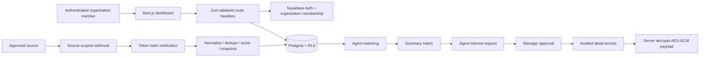

# EstatelQ architecture and implementation boundary

## Product boundary

EstatelQ is a real-estate opportunity intake, scoring, and agent-routing MVP. It is not a property scraper, an owner-contact broker, a CRM replacement, or a bulk messaging system. The app accepts manually entered records and normalized summaries from sources an organization has approved. A separate business-prospect module queries OpenStreetMap's community business records for agents, brokerages, and property managers; it does not scrape arbitrary websites or establish prospect intent.

Private property and owner details are separate from opportunity summaries. The agent first receives only a summary. A matched agent explicitly requests access, a manager approves or rejects the request, and only the requesting agent can retrieve details after approval. No owner outreach is automatically generated or sent.

## Runtime components

### Request boundaries

- Browser traffic uses the Supabase SSR session and anon/publishable key; database RLS remains mandatory.
- Authenticated app endpoints derive tenant scope from `organization_members`, not request payloads.
- Webhook ingestion uses a high-entropy, per-source bearer token. Only the SHA-256 token hash is stored. The endpoint uses a server-only Supabase service-role key after validating that token and its source's approval/active status.
- Public-feed webhook schemas omit private details. A source cannot submit full addresses, owner contacts, or arbitrary unvalidated columns through that route.
- Private data entered in the manager UI is encrypted in the server process using AES-256-GCM before insert. The encryption key is never passed to the browser or database.

## Data model

Migration `202610180001_leadforge_core.sql` contains the original organization membership, inbound buyer-lead, follow-up, scoring-detail, and audit foundation. Migration `202610250001_opportunity_workflows.sql` adds the opportunity model:

| Table | Purpose |
| --- | --- |
| `organizations` | Tenant root, created through the authenticated organization bootstrap function |
| `users` | Auth user profile fields |
| `organization_members` | Existing membership and role boundary |
| `agents` | Organization-linked member identity and active state |
| `agent_profiles` | Areas, specialties, currency, and budget range used for matching |
| `agent_preferences` | Agent-level notification and opt-out preferences |
| `teams` | Organization team grouping |
| `listing_sources` | Source type, HTTPS location, review state, and source-token hash |
| `source_snapshots` | Fingerprint and minimized, non-private listing metadata |
| `source_health` | Last successful ingestion and consecutive failure state |
| `listings` | Canonical, privacy-safe opportunity summary, market fields, lifecycle, and dedupe key |
| `owners` | Listing owner verification state without plaintext owner identity |
| `owner_contacts` | Encrypted contact payload, permission state, and opt-out timestamp |
| `listing_private_details` | AES-GCM ciphertext, IV, authentication tag, and key version for address/owner detail |
| `listing_verifications` | Human review state and evidence reference |
| `listing_scores` | Versioned trust, owner-led, urgency, quality, and explainable factors |
| `matches` | Ranked listing-to-agent fit with reasons |
| `interest_requests` | Explicit agent request and decision state |
| `approvals` | Reviewer, decision, reason, and revocation state |
| `outreach_messages` | Summary-only match notification audit and delivery state |
| `campaigns` | Minimal organization campaign grouping |
| `subscriptions` | Recurring subscription schema; recurring billing is not implemented |
| `lead_purchases` | One free verified-lead sample per organization and Stripe-confirmed one-time unlocks |
| `business_prospects` | OpenStreetMap-sourced business records and organization-owned review stage/notes |
| `business_prospect_search_control` | Global and per-organization throttle state for public geocoding searches |
| `business_prospect_outreach` | Individually reviewed business emails and delivery state |
| `business_prospect_email_opt_outs` | Workspace-level email-address suppression records |
| `business_prospect_opt_out_tokens` | Hashed tokens for email link opt-out confirmation |
| `audit_logs` | Organization-scoped event trail for decisions, ingestion, suppression, and detail release |

Legacy `leads` records represent inbound buyer enquiries; they are not property opportunities. The `/api/leads` handler is retained for that schema and no longer returns demo data. The opportunity experience uses `/api/listings`.

## Ingestion and scoring

`src/lib/opportunities.ts` owns canonical input validation, normalization, dedupe-key construction, explainable listing scoring, and agent fit scoring. API routes:

- enforce membership/role or source-token authorization;
- derive organization scope from the authenticated membership or matched source record;
- normalize and limit supported fields;
- check organization-level duplicates before insert;
- save only a minimized snapshot and scoring factors;
- record source success and an audit event.

The source-health record is updated by a successful ingestion; there is no scheduled remote source probe or autonomous crawler. External adapters must be legally approved and normalize to the documented Zod shape before posting.

Business prospect discovery geocodes a manager-submitted area using Nominatim and queries Overpass for mapped estate agencies or property managers within a bounded radius. Results are deduplicated by OpenStreetMap object identity and stored with source attribution; organization members manage review stage and internal notes. A database-backed throttle limits one search per organization every 30 seconds and one geocoding request per second globally for this deployment. This is a public, community-maintained dataset, not a comprehensive or verified agent directory; contact fields are often absent or stale. Managers can compose and individually confirm an email to a listed business inbox. Address-level opt-outs, one-send-per-prospect-per-30-days, a 20-send daily organization cap, a database reservation RPC, and audit records protect the workflow. Bulk sends and automatic prospect emails are not implemented. OpenStreetMap database licensing and attribution obligations apply.

Listing scoring is deterministic and versioned. It combines source quality, owner-listed claim (not owner verification), record completeness, and recency. Agent matching ranks only active agents using city/region, property specialty, and compatible budget/currency. A score is a triage aid, not a verified valuation, ownership claim, or legal judgment.

## Approval and privacy sequence

1. A manager stores optional private details as authenticated-app input. The server encrypts them and stores only ciphertext/nonce/tag. Contact permission defaults to `unknown`.
2. A manager may verify an owner-listed claim against a reference and rationale. Verification alone never grants detail access.
3. The manager computes matches; matching output and any in-app notice contain only listing summaries.
4. A matched agent may create one explicit interest request for that match.
5. A manager must approve or reject with a reason. RLS requires the request and a corresponding approved approval.
6. For owner-seller claims, the manager approval endpoint verifies the owner state and prepares the free sample or paid entitlement. A paid entitlement is granted only by the signed Stripe webhook.
7. The detail handler verifies the signed-in active agent is the matched agent, checks interest plus approval and any required purchase entitlement, checks suppression, decrypts on the server, and writes an audit event before returning the response.
8. Suppression prevents future detail reads and revokes related approval state. A verified owner opt-out also marks contact permission as opted out.

RLS protects direct table access as well as application routes. Private data tables store ciphertext; only the server has the decryption key. Service-role access is restricted to the source-token endpoint and must remain server-only.

## Background workflows

`n8n/workflows/lead-discovery-and-ingestion.json` is an inactive template. It is designed to receive a controlled source payload, reject private fields, and forward a public summary using a source-scoped bearer token. It does not fetch or scrape sites. The application does not report the workflow as connected or healthy.

Automated scoring/matching runs as route-level server logic. Reminders, source polling, CRM synchronization, email delivery, and retries are not implemented.

## Known architecture gaps

- No automated database integration tests or organization-switching UI.
- No managed agent invitations or full team administration UX; business prospects are currently an internal research queue only.
- No real third-party feed adapter, scheduler, source probing, or adapter-level throttling.
- No transaction/RPC boundary spanning every ingestion side effect; API returns explicit processing errors, but an operator may need to inspect partially written records.
- No encryption key rotation/re-encryption tool.
- No global rate limiting outside the explicit OpenStreetMap search throttles, recurring billing, or production monitoring.

These are explicit remaining work, not represented as completed integrations.
